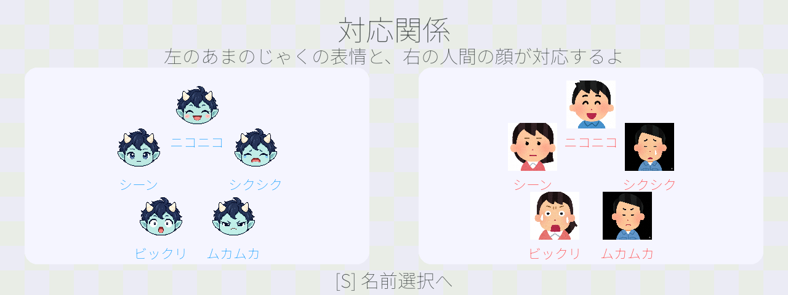

# あまのじゃくゲーム

[](https://github.com/Aokingetrix/amanojaku-expression-game/actions/workflows/ci.yml)

Webカメラに向かって、画面のキャラクターと**違う表情**を作るゲームです。



## 遊び方

制限時間内に違う表情を作ると得点が増えます。同じ表情・無表情・顔が映っていない場合はライフが減り、3回の失敗でゲーム終了です。得点が上がると、制限時間が短くなり、キャラクターの数も増えます。

- `S`：スタート・次へ
- `Enter`：名前選択の決定
- `Shift+Esc`：終了

[詳しい操作・カメラ設定](docs/usage.md)

## 起動

Python 3.11とWebカメラが必要です。Windows 10/11、Linux向けに実装しています。

[`uv`](https://docs.astral.sh/uv/getting-started/installation/)を使う場合：

```bash
git clone https://github.com/Aokingetrix/amanojaku-expression-game.git
cd amanojaku-expression-game
uv venv --python 3.11 .venv
uv pip install --python .venv -r deepface_ver/requirements.txt
```

Windows PowerShell：

```powershell
.\.venv\Scripts\python.exe -m deepface_ver.scripts.main
```

Linux：

```bash
.venv/bin/python -m deepface_ver.scripts.main
```

初回は表情認識モデルのダウンロードに時間がかかります。[pipでのセットアップ・困ったときの対処](docs/usage.md#セットアップ)も参照してください。

## 仕組みを知る

Python・Pygame・OpenCV・DeepFaceを使用しています。

- [アーキテクチャ](docs/architecture.md)：表情認識と画面更新の分離、ゲーム判定、描画キャッシュ
- [開発ガイド](docs/development.md)：テスト、CI、テーマ変更、素材生成

## 制作

EEIC後期実験で個人制作し、文化祭でも公開しました。企画から実装・動作確認まで制作全体を担当し、開発にはGeminiとCodexを全面的に使用しました。

制作：[Aokingetrix](https://github.com/Aokingetrix)

## ライセンス

[PolyForm Noncommercial 1.0.0](LICENSE)の条件で、非商用の利用・改変・再配布を認めています。第三者素材には各提供元の利用条件が適用されます。

[素材のクレジットと利用条件](ATTRIBUTIONS.md)
