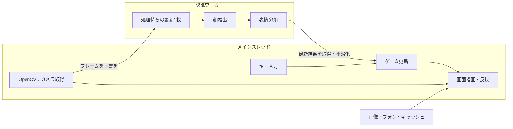

# アーキテクチャ

ゲームの画面更新をPygame、カメラ取得と顔検出をOpenCV、表情分類をDeepFaceが担当します。`application.py`が各処理をつなぎ、ゲームの進行と判定を`GameManager`で管理します。

## 画面更新と表情認識

カメラ取得と描画はメインスレッドで行い、表情認識を別スレッドに分けています。画面更新の上限は30 FPSです。

`submit_frame()`は処理待ちのフレームを最新の1枚で置き換えます。認識に時間がかかる場合も、新しい入力へ追従しやすい構成です。`get_latest_result()`から結果と世代番号を取得し、結果が更新されたときに最新3件の多数決で表示用の表情を決めます。

## 表情分類からゲーム判定まで

1. フレームの明るさを調整し、0.75倍へ縮小します。
2. Haar Cascadeで顔を検出し、顔領域を切り出します。
3. DeepFaceで分類し、7種類の分類結果をゲーム用の5種類へまとめます。`disgust`は「ムカムカ」、`fear`は「ビックリ」に合算します。
4. 各ラウンドの最後の1秒間に得られた平滑化後の表情を集め、多数決で判定します。

顔の検出結果と分類結果は、表情・座標・状態等を持つ辞書で渡します。顔が見つからない状態も判定側へ渡し、ライフと得点に反映します。

## ゲームの進行

基本の流れは、タイトル→説明→表情対応表→名前選択→カウントダウン→ラウンド案内→プレイ→結果です。結果画面から次のラウンドへ進み、ライフがなくなるとランキングを表示します。

キー入力は`GameManager.update()`で`GameCommand`にまとめ、`handle()`が状態に応じて処理します。判定結果は`RoundOutcome`に得点・ライフの増減とメッセージをまとめます。名前選択は`NameSelector`が管理し、確定後にゲームを開始します。

時計、乱数、音声を差し替えられるため、テストでは時刻と出題を固定して、状態遷移・得点・ライフを確認できます。ルールの実装は[game_manager.py](../deepface_ver/core/game_manager.py)にあります。

## 描画とキャッシュ

論理解像度は1280×480、カメラ映像は640×480です。ウィンドウサイズが変わると、アスペクト比を維持して論理画面を拡大・縮小します。

[assets.py](../deepface_ver/core/assets.py)は、画像のデコード結果、contain／coverの拡大結果、フォントをキャッシュします。テーマ確定後に画像と通常画面のフォントを読み込み、繰り返し使う素材を再利用します。LRUで保持件数を制限し、テーマによって増えるメモリ使用量を抑えています。

## 保存とテーマ

[HighscoreStore](../deepface_ver/core/highscore.py)が、名前別・日別のランキングを扱います。保存時は一時ファイルを書き、旧ファイルをバックアップへ移してから本体を置き換えます。読み込み時に本体が破損していればバックアップを使います。

[テーマローダー](../deepface_ver/core/theme.py)は、同梱テーマに外部テーマの指定項目を上書きします。画像・背景・音声・表示文をゲームルールと分け、ハイスコアもテーマID別に保存します。

## コードを読む入口

| ファイル・ディレクトリ | 担当 |
| --- | --- |
| [application.py](../deepface_ver/application.py) | 初期化、入力、状態更新、音声、描画の接続 |
| [emo/emo_recog.py](../deepface_ver/emo/emo_recog.py) | カメラ取得、認識ワーカー、分類結果の変換 |
| [core/](../deepface_ver/core/) | ゲームルール、保存、テーマ、キャッシュ |
| [ui/](../deepface_ver/ui/) | 画面別描画、名前選択、UI部品 |
| [tests/](../deepface_ver/tests/) | 状態遷移・保存・描画等のテスト |

[開発ガイド](development.md) / [操作ガイド](usage.md)
