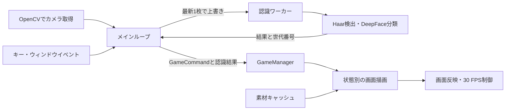

# 設計と処理の流れ

## メインループと認識ワーカー

`application.py`が入力、カメラ、認識、状態機械、描画を接続します。
カメラ取得自体はメインスレッドです。認識ワーカーは最新フレームを連続処理します。
入力側が速くてもフレームを蓄積せず、古い未処理フレームを上書きして待ち行列による遅延を抑えます。
CPU共有・カメラ取得・初期化等による負荷はあるため、推論を別スレッドにするだけで表示FPSが保証されるわけではありません。

## ゲーム状態

通常の流れは、タイトル→説明選択→説明→表情対応表→名前選択→カウントダウン→ラウンド案内→プレイ→判定→結果です。
結果画面から次のラウンドへ進み、ライフがなくなると終了・ランキング画面へ移ります。

`GameManager`は`GameCommand`を受け取り、Pygameのイベントオブジェクトを直接扱いません。
単調時計と乱数を注入できるため、実時間を待たずにカウントダウンやラウンド判定をテストできます。
`RoundOutcome`は得点・ライフ増減・表示メッセージをまとめます。

## 画像とフォント

`core/assets.py`が元画像・contain/cover拡大結果・フォントをキャッシュします。
元画像は最大32件、各拡大方式は最大64件で、外部テーマ利用時にも件数を制限します。
テーマ決定後に通常素材・フォントを読み込み、フレームごとのファイル読み込みを減らします。
画像の実行中ホットリロードは実装していません。

UIは1280×480で描画し、別ウィンドウサイズではアスペクト比を維持して拡大・縮小します。
カメラ映像は640×480へ正規化します。日本語フォントは同梱Noto Sans JPを優先します。

## 保存とテーマ

`HighscoreStore`は保存先と時計を引数で受け取ります。
保存は一時ファイル作成→旧ファイルをバックアップへ移動→一時ファイルを本体へ置換する順序です。
読み込み時に本体が不正JSON等ならバックアップを試し、両方を読めなければ初期値を返します。
完全な電源断耐性やOSのディスク同期までを保証する設計ではありません。

`theme.toml`の外部上書きは素材・表示文に限り、得点や制限時間等のルールは含めません。
未指定項目は同梱テーマへフォールバックし、指定された素材がなければ起動時にエラーにします。

## 今後の改善候補

- `emo/emo_recog.py`に残る旧API・命名と`application.py`の責務整理。
- Linux実機でのカメラ・日本語・音声・実推論確認。
- 照明・顔の向き・複数人時の認識結果を定量評価。
- 新素材での実測条件を残した表示FPS・推論時間の計測。
